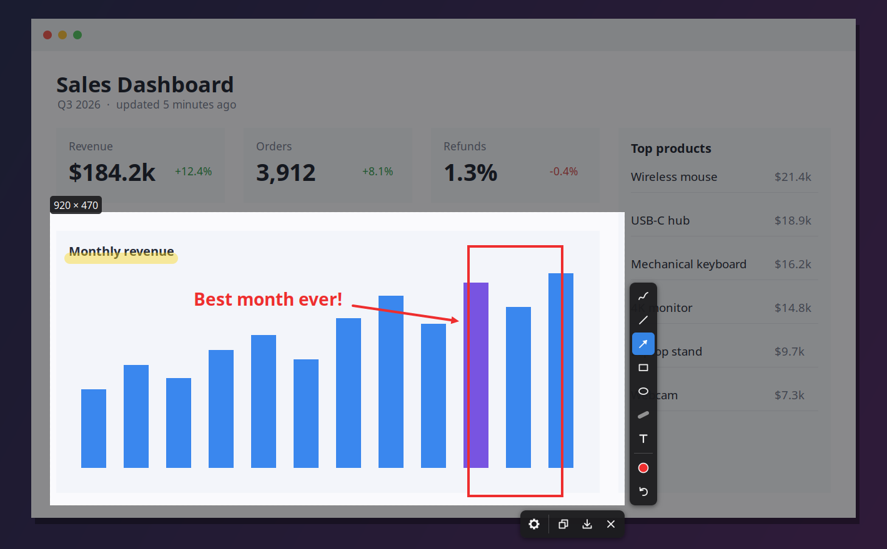
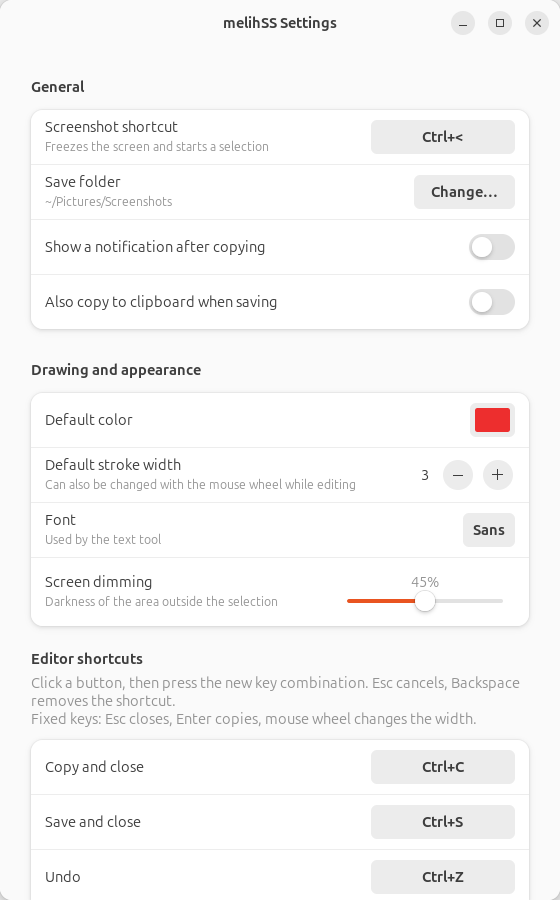

<p align="center">
  <b>English</b> · <a href="README.tr.md">Türkçe</a>
</p>

<p align="center">
  
</p>

<h1 align="center">melihSS</h1>

<p align="center">
  <b>A fast, Lightshot-style screenshot tool for Ubuntu / GNOME on Wayland.</b><br>
  Press a hotkey, drag a region, annotate it in place and hit <kbd>Ctrl</kbd>+<kbd>C</kbd>. Done.
</p>

<p align="center">
  
  
  
  
</p>

<p align="center">
  
</p>

## Why?

GNOME's built-in screenshot UI is great for taking screenshots, but not for
*explaining* something quickly. melihSS brings the classic Lightshot workflow to
modern GNOME on Wayland: the editor appears right next to your selection, so you
can draw a box, an arrow or a note and paste the result into chat in about two
seconds, without opening another app.

## Features

- **Instant region capture**: the screen freezes as soon as you press the hotkey.
- **Move and resize the selection** with its edges and corners, and see its size in pixels.
- **In-place annotation tools**: pen, line, arrow, rectangle, ellipse, highlighter and text.
- **Colors**: an 8-color palette plus a custom color picker.
- **Stroke width and text size** change with the mouse wheel.
- **Undo / redo** for every annotation.
- **<kbd>Ctrl</kbd>+<kbd>C</kbd> copies the image and closes** the editor, ready to paste anywhere.
- **<kbd>Ctrl</kbd>+<kbd>S</kbd> saves** a PNG to `~/Pictures/Screenshots` (configurable).
- **Settings window** where you can rebind every shortcut, including the global hotkey.
- **HiDPI aware**: the output is always rendered at the screen's native resolution.
- **Single file, no build step**: plain Python using GTK 4 and libadwaita.

<p align="center">
  
</p>

## Requirements

- GNOME on Wayland (tested on **Ubuntu 24.04**, GNOME 46)
- Python 3.10+ with PyGObject, GTK 4 (4.12+) and libadwaita (1.4+)
- `wl-clipboard` for copying images
- `libnotify-bin` for notifications

On Ubuntu / Debian:

```bash
sudo apt install python3-gi python3-gi-cairo gir1.2-gtk-4.0 gir1.2-adw-1 wl-clipboard libnotify-bin
```

## Installation

```bash
git clone https://github.com/EkizceMelih/ubuntu-screenshoot-app-the-best.git
cd ubuntu-screenshoot-app-the-best
./install.sh
```

The installer runs entirely as your user (no `sudo`). It:

1. copies `melihss.py` to `~/.local/bin/melihss`,
2. installs the icon and a desktop entry, so melihSS shows up in the app grid and can be pinned to the dock,
3. grants melihSS permission to use the screenshot portal,
4. binds the global hotkey (default <kbd>Shift</kbd>+<kbd>Super</kbd>+<kbd>S</kbd>).

To use a different hotkey, pass it in [GTK accelerator syntax](https://docs.gtk.org/gtk4/func.accelerator_parse.html):

```bash
./install.sh --shortcut '<Control>less'   # Ctrl + <
./install.sh --shortcut 'Print'           # Print Screen (unbind GNOME's own first)
./install.sh --no-shortcut                # leave keyboard shortcuts alone
```

You can also change the hotkey later in the settings window.

## Usage

Press the hotkey (or click the dock icon), drag over the area you want and annotate it.

| Key | Action |
| --- | --- |
| <kbd>Ctrl</kbd>+<kbd>C</kbd> / <kbd>Enter</kbd> | Copy to clipboard and close |
| <kbd>Ctrl</kbd>+<kbd>S</kbd> | Save as PNG and close |
| <kbd>Ctrl</kbd>+<kbd>Z</kbd> / <kbd>Ctrl</kbd>+<kbd>Y</kbd> | Undo / redo |
| <kbd>Esc</kbd> | Close (or finish the text you are typing) |
| Mouse wheel | Stroke width / text size |
| <kbd>P</kbd> <kbd>L</kbd> <kbd>A</kbd> <kbd>R</kbd> <kbd>E</kbd> <kbd>M</kbd> <kbd>T</kbd> | Pen, Line, Arrow, Rectangle, Ellipse, Highlighter (Marker), Text |
| <kbd>Shift</kbd>+<kbd>Enter</kbd> | New line in the text tool |

Without a selection, <kbd>Ctrl</kbd>+<kbd>C</kbd> copies the whole screen.
Click the active tool again to go back to moving and resizing the selection.

### Settings

Open the settings with the ⚙ button in the editor, by right-clicking the dock icon and
choosing **Settings**, or from a terminal:

```bash
melihss --settings
```

Settings are stored in `~/.config/melihss/config.json`.

## How it works

Wayland does not let ordinary applications read the screen. melihSS asks the
[XDG Screenshot portal](https://flatpak.github.io/xdg-desktop-portal/docs/doc-org.freedesktop.portal.Screenshot.html)
for a non-interactive full-screen capture (about 0.5 s), shows it frozen in a
fullscreen GTK 4 window, and does all selection and drawing with cairo.
Copying goes through `wl-copy`, so the image stays on the clipboard after
melihSS exits.

## Troubleshooting

**"Could not take a screenshot: screenshot permission denied"**: GNOME requires
permission for non-interactive screenshots. Running `./install.sh` again grants
it. To grant it by hand:

```bash
gdbus call --session --dest org.freedesktop.impl.portal.PermissionStore \
  --object-path /org/freedesktop/impl/portal/PermissionStore \
  --method org.freedesktop.impl.portal.PermissionStore.SetPermission \
  screenshot true screenshot melihss "['yes']"
```

**The hotkey does nothing**: check it under *Settings → Keyboard → View and Customize
Shortcuts → Custom Shortcuts* and make sure no other app uses the same key.

**Pasting gives nothing**: make sure `wl-clipboard` is installed (`wl-copy --version`).

## Uninstall

```bash
./uninstall.sh           # keeps your settings
./uninstall.sh --purge   # also removes ~/.config/melihss
```

## Contributing

Issues and pull requests are welcome. The whole app lives in
[`melihss.py`](melihss.py), and you can run it straight from the repository:

```bash
python3 melihss.py             # capture
python3 melihss.py --settings  # settings window
```

## Author

**Melih Ekizce**

[](https://www.linkedin.com/in/melihekizce/)
[](https://github.com/EkizceMelih)

## License

[MIT](LICENSE) © 2026 Melih Ekizce
