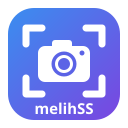
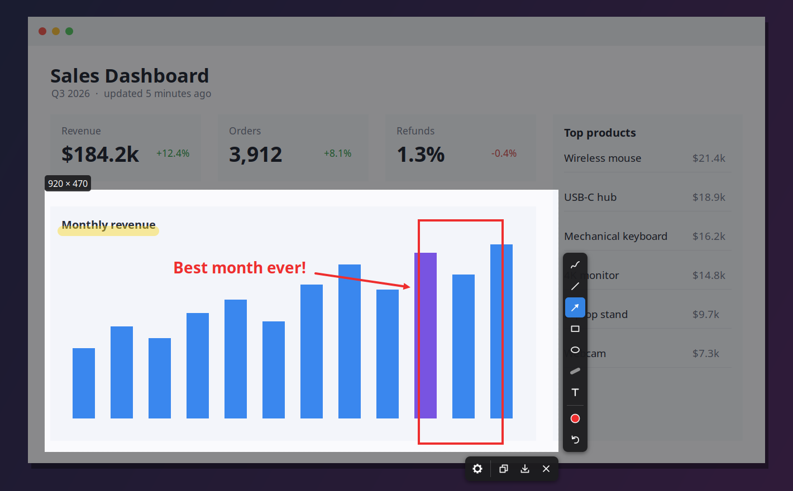
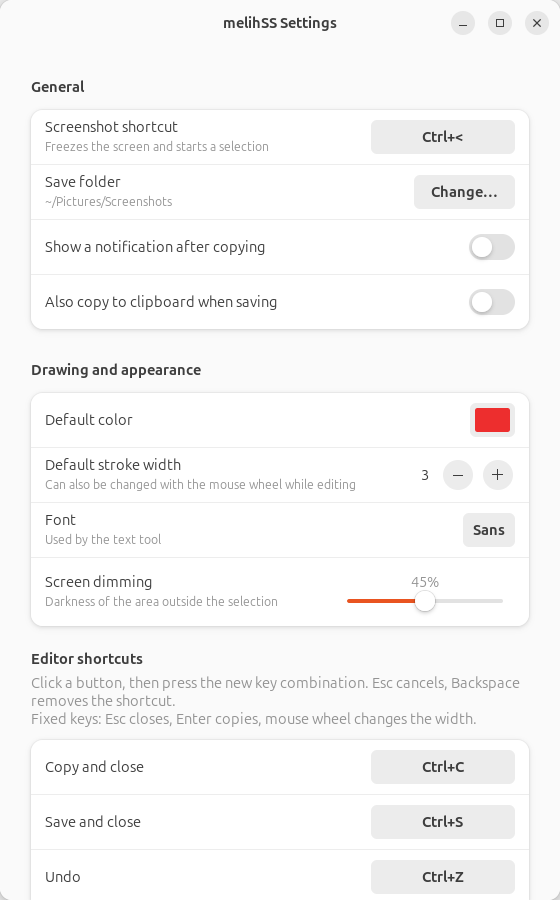

<p align="center">
  <a href="README.md">English</a> · <b>Türkçe</b>
</p>

<p align="center">
  
</p>

<h1 align="center">melihSS</h1>

<p align="center">
  <b>Ubuntu / GNOME (Wayland) için hızlı, Lightshot tarzı ekran görüntüsü aracı.</b><br>
  Kısayola bas, alanı seç, üzerine çiz ve <kbd>Ctrl</kbd>+<kbd>C</kbd>'ye bas. Bu kadar.
</p>

<p align="center">
  
  
  
  
</p>

<p align="center">
  
</p>

## Neden?

GNOME'un kendi ekran görüntüsü aracı görüntü almak için iyi, ama bir şeyi hızlıca
*anlatmak* için yetersiz. melihSS, alışılmış Lightshot kullanımını Wayland üzerindeki
güncel GNOME'a getiriyor: düzenleme araçları seçtiğin alanın hemen yanında açılıyor.
Başka bir uygulama açmadan bir kutu, ok ya da not ekleyip sonucu yaklaşık iki saniyede
sohbete yapıştırabiliyorsun.

## Özellikler

- **Anında alan seçimi:** Kısayola bastığın an ekran donar.
- **Seçimi taşıma ve boyutlandırma:** Kenarlarından ve köşelerinden tutabilirsin, seçimin piksel boyutu ekranda görünür.
- **Seçimin yanında çizim araçları:** Kalem, çizgi, ok, dikdörtgen, elips, işaretleyici ve yazı.
- **Renkler:** 8 renklik palet ve özel renk seçici.
- **Çizgi kalınlığı ve yazı boyutu** fare tekerleğiyle değişir.
- **Geri al / yinele** her çizim için çalışır.
- **<kbd>Ctrl</kbd>+<kbd>C</kbd> görüntüyü kopyalar ve kapanır.** İstediğin yere yapıştırabilirsin.
- **<kbd>Ctrl</kbd>+<kbd>S</kbd>** PNG olarak `~/Pictures/Screenshots` klasörüne kaydeder (klasör değiştirilebilir).
- **Ayarlar penceresi:** Genel kısayol dahil bütün kısayolları değiştirebilirsin.
- **HiDPI desteği:** Çıktı her zaman ekranın gerçek çözünürlüğünde üretilir.
- **Tek dosya, derleme yok:** GTK 4 ve libadwaita kullanan düz Python.

<p align="center">
  
</p>

## Gereksinimler

- Wayland üzerinde GNOME (**Ubuntu 24.04**, GNOME 46 ile test edildi)
- PyGObject, GTK 4 (4.12+) ve libadwaita (1.4+) içeren Python 3.10+
- Görüntüyü panoya kopyalamak için `wl-clipboard`
- Bildirimler için `libnotify-bin`

Ubuntu / Debian için:

```bash
sudo apt install python3-gi python3-gi-cairo gir1.2-gtk-4.0 gir1.2-adw-1 wl-clipboard libnotify-bin
```

## Kurulum

```bash
git clone https://github.com/EkizceMelih/ubuntu-screenshoot-app-the-best.git
cd ubuntu-screenshoot-app-the-best
./install.sh
```

Kurulum tamamen senin kullanıcınla çalışır, `sudo` gerekmez. Kurulum scripti:

1. `melihss.py` dosyasını `~/.local/bin/melihss` olarak kopyalar,
2. simgeyi ve uygulama menüsü girişini kurar; böylece melihSS uygulama listesinde görünür ve dock'a sabitlenebilir,
3. melihSS'e ekran görüntüsü servisini kullanma izni verir,
4. genel kısayolu atar (varsayılan: <kbd>Shift</kbd>+<kbd>Super</kbd>+<kbd>S</kbd>).

Başka bir kısayol kullanmak için [GTK kısayol yazımıyla](https://docs.gtk.org/gtk4/func.accelerator_parse.html) belirtebilirsin:

```bash
./install.sh --shortcut '<Control>less'   # Ctrl + < (Türkçe klavye)
./install.sh --shortcut 'Print'           # Print Screen (önce GNOME'un kendi atamasını kaldır)
./install.sh --no-shortcut                # klavye kısayollarına dokunma
```

Kısayolu daha sonra ayarlar penceresinden de değiştirebilirsin.

## Kullanım

Kısayola bas (ya da dock'taki simgeye tıkla), istediğin alanı fareyle seç ve üzerine çiz.

| Tuş | İşlev |
| --- | --- |
| <kbd>Ctrl</kbd>+<kbd>C</kbd> / <kbd>Enter</kbd> | Panoya kopyala ve kapat |
| <kbd>Ctrl</kbd>+<kbd>S</kbd> | PNG olarak kaydet ve kapat |
| <kbd>Ctrl</kbd>+<kbd>Z</kbd> / <kbd>Ctrl</kbd>+<kbd>Y</kbd> | Geri al / yinele |
| <kbd>Esc</kbd> | Kapat (yazı yazarken yazıyı bitirir) |
| Fare tekerleği | Çizgi kalınlığı / yazı boyutu |
| <kbd>P</kbd> <kbd>L</kbd> <kbd>A</kbd> <kbd>R</kbd> <kbd>E</kbd> <kbd>M</kbd> <kbd>T</kbd> | Kalem, çizgi, ok, dikdörtgen, elips, işaretleyici, yazı |
| <kbd>Shift</kbd>+<kbd>Enter</kbd> | Yazı aracında yeni satır |

Seçim yapmadan <kbd>Ctrl</kbd>+<kbd>C</kbd>'ye basarsan tüm ekran kopyalanır.
Seçimi yeniden taşımak ya da boyutlandırmak için seçili araca bir kez daha tıkla.

### Ayarlar

Ayarları düzenleme ekranındaki ⚙ düğmesiyle, dock simgesine sağ tıklayıp
**Settings** seçerek ya da terminalden açabilirsin:

```bash
melihss --settings
```

Ayarlar `~/.config/melihss/config.json` dosyasında saklanır.

> Not: Uygulamanın arayüzü İngilizcedir.

## Nasıl çalışır?

Wayland, sıradan uygulamaların ekranı okumasına izin vermez. melihSS,
[XDG Screenshot portalından](https://flatpak.github.io/xdg-desktop-portal/docs/doc-org.freedesktop.portal.Screenshot.html)
etkileşimsiz bir tam ekran görüntüsü ister (yaklaşık 0,5 saniye). Bu görüntüyü tam
ekran bir GTK 4 penceresinde donmuş olarak gösterir; seçim ve çizimlerin hepsi cairo
ile yapılır. Kopyalama `wl-copy` üzerinden yapıldığı için görüntü, melihSS kapandıktan
sonra da panoda kalır.

## Sorun giderme

**"Could not take a screenshot: screenshot permission denied" hatası:** GNOME,
etkileşimsiz ekran görüntüleri için izin ister. `./install.sh` komutunu tekrar
çalıştırmak bu izni verir. Elle vermek için:

```bash
gdbus call --session --dest org.freedesktop.impl.portal.PermissionStore \
  --object-path /org/freedesktop/impl/portal/PermissionStore \
  --method org.freedesktop.impl.portal.PermissionStore.SetPermission \
  screenshot true screenshot melihss "['yes']"
```

**Kısayol hiçbir şey yapmıyor:** *Ayarlar → Klavye → Kısayolları Görüntüle ve Özelleştir →
Özel Kısayollar* bölümünden kontrol et ve aynı tuşu başka bir uygulamanın kullanmadığından emin ol.

**Yapıştırınca bir şey gelmiyor:** `wl-clipboard` paketinin kurulu olduğundan emin ol (`wl-copy --version`).

## Kaldırma

```bash
./uninstall.sh           # ayarlarını korur
./uninstall.sh --purge   # ~/.config/melihss klasörünü de siler
```

## Katkıda bulunma

Hata bildirimleri ve pull request'ler memnuniyetle karşılanır. Uygulamanın tamamı
[`melihss.py`](melihss.py) dosyasında; doğrudan depodan çalıştırabilirsin:

```bash
python3 melihss.py             # ekran görüntüsü al
python3 melihss.py --settings  # ayarlar penceresi
```

## Lisans

[MIT](LICENSE) © 2026 Melih Ekizce
